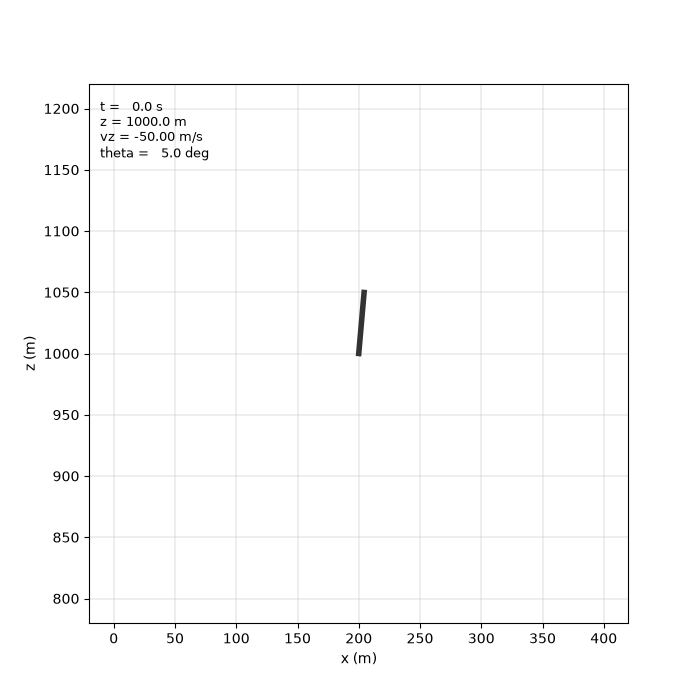
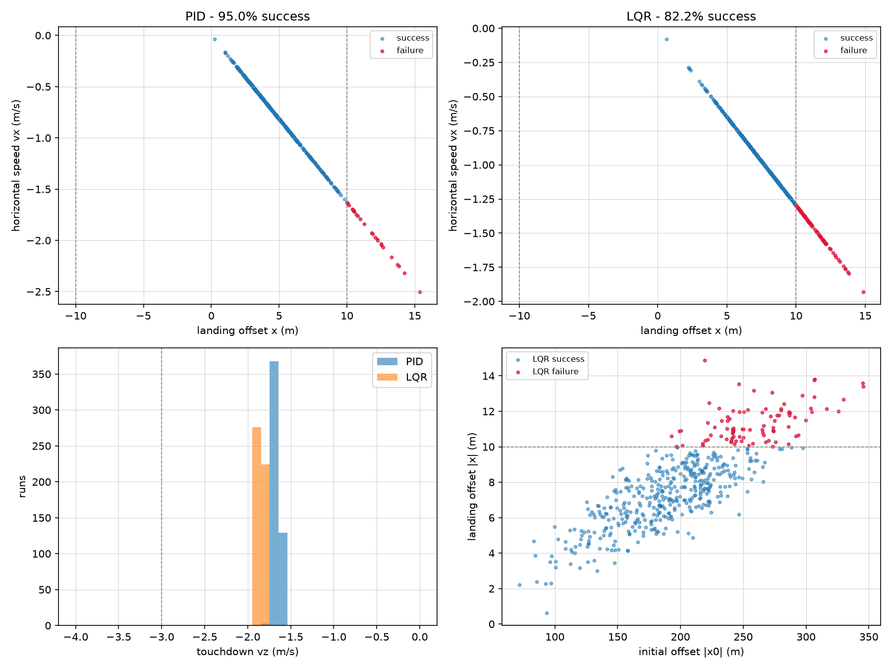

# 2D Rocket Landing Simulator

A planar rocket landing simulator with a cascaded PID guidance and control system, written in Python, with an LQR controller for comparison. The rocket has to remove its sideways offset and land with almost zero speed, using only throttle and a gimballed engine.



## Problem

A rocket stage begins 1000 m up, 200 m off target, tilted by 5°, and going down at 50 m/s.
Two control inputs are available: thrust magnitude `T` and gimbal angle `δ`.
The vehicle is underactuated, with two inputs for three degrees of freedom, so horizontal motion can only be reached by first tilting the body.

## Model

State vector: `[x, z, θ, ẋ, ż, θ̇]`

Equations of motion:

```
ẍ = T·sin(θ + δ) / m
z̈ = T·cos(θ + δ) / m − g
θ̈ = T·L·sin(δ) / I
ṁ = −T / (Isp·g₀)
```

Conventions: `x` horizontal, `z` vertical up, `θ` measured from the vertical and positive when the nose tilts toward `+x`, `δ` positive when it produces positive `θ̈`. This deviates from the aerospace NED convention (z down) so that altitude stays positive. Integrated with fixed-step RK4 at `dt = 0.01 s`.

## Control architecture

Three loops:

| Loop | Input | Output | Gains |
|---|---|---|---|
| Throttle | descent rate error | `T` | kp 120000, ki 20000, kd 8000 |
| Position (outer) | horizontal offset | `θ_cmd` | kp 0.006, ki 0, kd 0.05 |
| Attitude (inner) | pitch error | `δ` | kp 1.5, ki 0, kd 1.5 |

The descent rate target is `ż = −√(2·a·z) − b` with `a = 2 m/s²` and `b = 1 m/s`, so the commanded rate shrinks as the ground approaches.
Actuator limits are enforced: `δ` clamped to ±15°, `θ_cmd` to ±20°, `T` to `[0, T_max]`.

The throttle loop was tuned first, on its own, with the rocket moving only up and down. With proportional control alone, the rocket touched down at −4.64 m/s; adding derivative gain changed little (−4.33 m/s), raising kp to 120000 reached −2.33 m/s, and adding the integral term removed the remaining lag, giving −1.68 m/s. The error left over was due to the speed always staying behind the target rather than oscillating, which is why the integral term rather than the derivative term was the one that made a difference. Landing softer used more fuel: 6% more fuel for a 64% reduction in touchdown speed.

**Tuning:**
An initial tuning with the position loop at kp = 0.02, kd = 0.12 landed closest to the target of all the settings tested, at 3.2 m. From t = 13 s onward, the gimbal jumped between +15° and −15° at every step. No real actuator can swing from one limit to the other 100 times per second, so the 3.2 m result doesn't count. The outer position loop was sending commands faster than the inner attitude loop could follow: a 10° step response in the attitude loop took around 10 s to settle down. The outer loop was slowed to kp = 0.006, kd = 0.05, and then the attitude P gain was increased to 1.5, keeping D at 1.5. Raising attitude D instead brought the chatter back, since the derivative term reacts to how fast the commanded angle changes, so it made the jumps bigger, not smaller. The final settings land 4.75 m from the target rather than 3.2 m; landing further away was the price for a gimbal movement that a real engine could follow.

**LQR comparison:**
As a comparison, an LQR controller was also built. Instead of tuning the gains by hand, LQR takes a simplified version of the model and a set of weights that say how much each error matters, and calculates the best gains itself. The equations were simplified around hover (rocket upright, no gimbal, thrust equal to weight), where sin θ ≈ θ and cos θ ≈ 1. Scipy then solved the Riccati equation and gave the gain matrix K. The gains split in two on their own: thrust only reacts to altitude and vertical speed, and the gimbal only reacts to horizontal position, tilt and their speeds. That is the same split as the PID cascade, except nobody designed it this time.

Choosing the weights was the hard part. The first try weighted horizontal position the same as everything else. With the rocket starting 200 m to the side, this asked the gimbal for −20 rad, while its limit is 0.26 rad, so 76 times too much. The rocket tumbled (θ reached −460°) and hit the ground at −115 m/s. LQR doesn't know the gimbal has limits, so the weights have to be chosen so that the commands stay inside them. The fix was a much smaller weight on horizontal position and a much bigger one on tilt.

Starting from the same conditions, the tuned PID does better than the tuned LQR on every number (4.75 m versus 8.02 m offset, −1.66 versus −1.83 m/s vertical). The two didn’t get the same amount of work: the PID gains were tuned by hand for two days on this specific case, while the LQR weights took less than an hour. But that doesn’t explain the result with random starting conditions. Over 500 random starting conditions, the PID succeeds on 95.0% of runs against the LQR’s 82.2%, and the LQR fails mostly when the rocket starts far to the side, not when it starts tilted. The difference comes from how the controllers are built, not from the tuning time: the PID has a hard limit on the pitch it can ask for, while the LQR doesn’t know the gimbal has limits and asks for more than exists when the rocket starts far away.

## Results

Nominal case, from 200 m offset and 1000 m altitude:

| Metric | PID cascade | LQR |
|---|---|---|
| Landing offset | 4.75 m | 8.02 m |
| Vertical touchdown speed | −1.66 m/s | −1.83 m/s |
| Horizontal touchdown speed | −0.78 m/s | −1.04 m/s |
| Touchdown attitude | 0.59° | 0.64° |
| Peak tilt | 20° (clamped) | 28.5° |
| Propellant used | 3270 kg | 3259 kg |
| Flight time | 29.4 s | 29.3 s |

The pitch command stays at the −20° limit for about 3 s while the rocket gets rid of the 200 m offset, so for that part of the descent, the controller is using everything it has.

## Monte Carlo

500 dispersed entry conditions, identical for both controllers (seeded, reproducible).
Dispersions are Gaussian about the nominal case:

| Variable | Mean | σ |
|---|---|---|
| x | 200 m | 50 m |
| z | 1000 m | 50 m |
| θ | 5° | 5° |
| ẋ | 0 m/s | 5 m/s |
| ż | −50 m/s | 5 m/s |
| θ̇ | 0°/s | 1°/s |

A run counts as a success if it reaches the ground within 10 m of target, below 2 m/s horizontal, below 3 m/s vertical, and within 5° of upright.

| Metric | PID cascade | LQR |
|---|---|---|
| Success rate | 95.0% | 82.2% |
| Median &#124;x&#124; | 4.61 m | 7.75 m |
| 95th percentile &#124;x&#124; | 9.98 m | 11.96 m |
| Median vertical speed | −1.67 m/s | −1.85 m/s |
| Mean propellant | 3264 kg | 3259 kg |

The 89 LQR failures mostly started far to the side: failed runs began 260 m from the target on average, against 186 m for the runs that landed. The starting tilt was almost the same in both groups (6.45° against 5.81°), so the distance causes the failures, not the tilt. It is the same problem as the tumble above, just smaller: a big horizontal error makes the LQR ask for more gimbal than exists, and then it has nothing left to control the tilt. The PID doesn't have this problem because its pitch command has a hard limit.



Something unexpected showed up in the Monte Carlo results: in all 500 runs, for both controllers, when landing distance is plotted against sideways speed at touchdown, every run falls on the same straight line. The rocket is still drifting sideways when it lands. The descent always takes about 29 s, because the vertical control decides the timing, and the distance left at landing is proportional to how fast it’s still drifting. Different starting conditions move a run along the line, never off it. So the problem is that horizontal control runs out of time, not that the controller is too weak. Fixing this would need a second phase at the end that only focuses on bringing x to zero.

## Validation

Freefall test with `T = 0`, compared against `z(t) = z₀ − ½gt²` over 10 s:
maximum error **2.04 × 10⁻¹¹ m**, at machine precision.
Open-loop tests confirm the sign conventions: a constant positive gimbal produces positive `θ`, and a zero gimbal produces no rotation or horizontal drift.

## Files

```
config.py       vehicle, engine, environment and gain constants
dynamics.py     equations of motion
integrator.py   RK4 stepper
controller.py   PID class and the cascaded Lander controller
land_1d.py      vertical-only landing (development)
land_2d.py      full 2D landing, importable run()
lqr.py          linearized matrices and Riccati solution
land_lqr.py     full 2D landing under LQR control
test_freefall.py, test_openloop.py, test_attitude.py
monte_carlo.py  500 dispersed runs, both controllers, caches to mc_results.npz
mc_plots.py     Monte Carlo analysis figures
animate.py      landing animation
```

## Running

```
python land_2d.py
```

Requires numpy, scipy, matplotlib.

## Limitations and future work

- No aerodynamics. Drag and wind are ignored.
- `L` and `I` are held constant, though both drift as propellant drains.
- Thrust and gimbal respond instantly; real actuators have lag and rate limits.
- Perfect state knowledge: no sensor model or estimator.
- The vehicle is modelled as a point mass with rotational inertia, so ground contact
  is evaluated on the centre of mass and the body length drawn in the animation is
  illustrative only.
- The guidance has only one phase. A second phase at the end, focused only on bringing x to zero, would fix the sideways drift at landing described above.
- Planned: EKF navigation from noisy IMU and altimeter measurements.